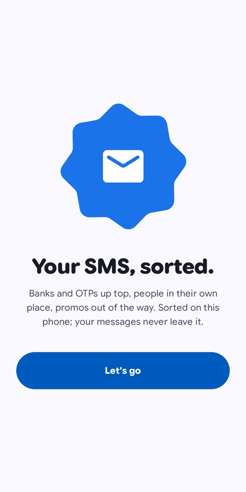
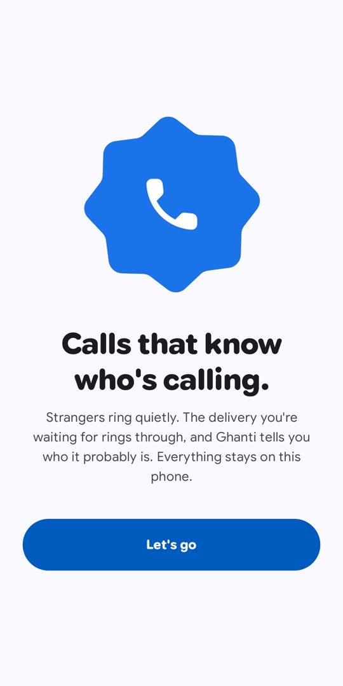
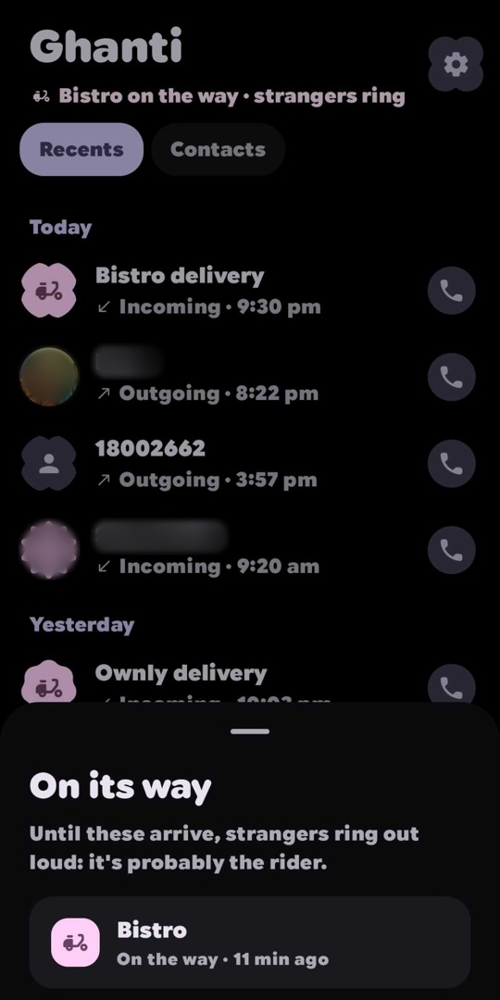
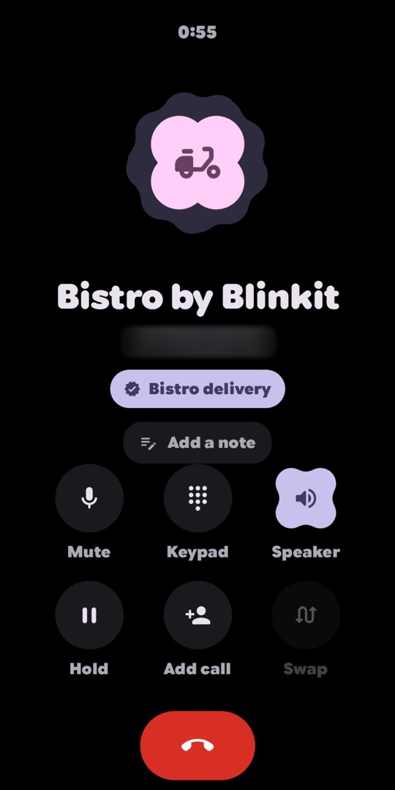

<h1 align="center">Tring</h1>

<p align="center">Your calls and messages, quietly sorted.</p>

<p align="center">
  <a href="https://play.google.com/store/apps/details?id=io.github.jaswantk917.chitthighanti"></a>
</p>

<p align="center">
  &nbsp;
  &nbsp;
  &nbsp;
  
</p>

Two apps in one install, each with its own icon. Use one, or both.

**Chitthi** is for messages. Codes and banks up top, people in their own place, promos out of the way.

**Ghanti** is for calls. Strangers ring quietly. The rider you're waiting for rings through, and Ghanti tells you who it probably is.

Everything stays on your phone. No accounts, no ads, no tracking, no servers.

## Chitthi

- Four tabs: Important, Personal, Promos, Unknown. Move a chat once and it stays moved.
- A fresh OTP waits at the top, ready to copy.
- Hold send to send later.
- Replies suggested on the device, where the phone supports it.

## Ghanti

- Strangers ring silently, unless an order or a ride is on its way.
- *Probably Bistro delivery*, on the call screen and in Recents.
- Someone who calls twice in three minutes always gets through.
- Notes during a call, saved as you type.
- Everything else a phone app should do: keypad with T9, hold, merge, swap, two SIMs.

## Blocking

Block a number and Android stops it before any app sees it. Rules catch the rest: `140` telemarketers, promotional senders, words, patterns. Your contacts are never caught.

<details>
<summary><b>Permissions</b></summary>

<br>

| Permission | Why |
|---|---|
| SMS | Only while Tring is your SMS app |
| Call log, phone | Only while Tring is your phone app |
| Contacts | Names, photos, and telling people from strangers |
| Notification access (optional) | Noticing deliveries on their way |
| Notifications, full screen | Messages, and calls over the lock screen |
| Exact alarms (optional) | Scheduled messages, to the minute |
| Internet | MMS through your carrier, and business logos |

[Privacy policy](https://jaswantk917.github.io/chitthi-ghanti/privacy.html)

</details>

<details>
<summary><b>Build</b></summary>

<br>

```sh
./gradlew :app:assembleDebug        # debug, installs beside the release
./gradlew :app:testDebugUnitTest    # tests
./gradlew :app:bundleRelease        # Play bundle
```

Release builds are signed with the keystore named by the `CG_UPLOAD_KEYSTORE`, `CG_UPLOAD_KEYSTORE_PASSWORD`, `CG_UPLOAD_KEY_ALIAS` and `CG_UPLOAD_KEY_PASSWORD` Gradle properties. Without them the build is unsigned.

Kotlin and Jetpack Compose, Material 3 Expressive. It began as two apps, [chitthi](https://github.com/jaswantk917/chitthi) and [ghanti](https://github.com/jaswantk917/ghanti).

</details>

<br>

<p align="center"><i>Made for the love of it.<br>Simple. Intuitive. No nonsense. Beautiful.</i></p>
