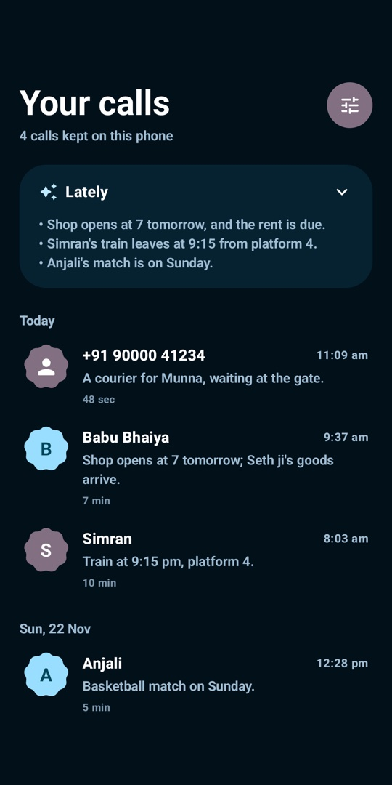
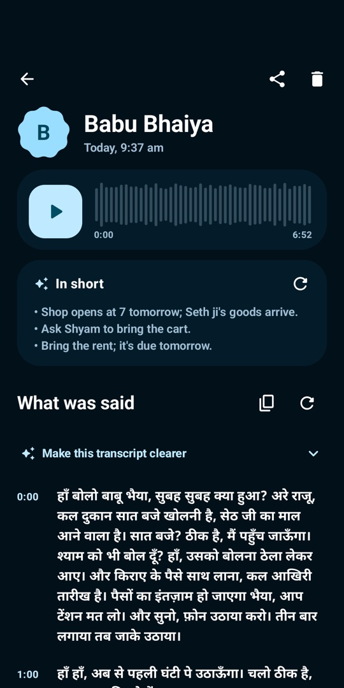
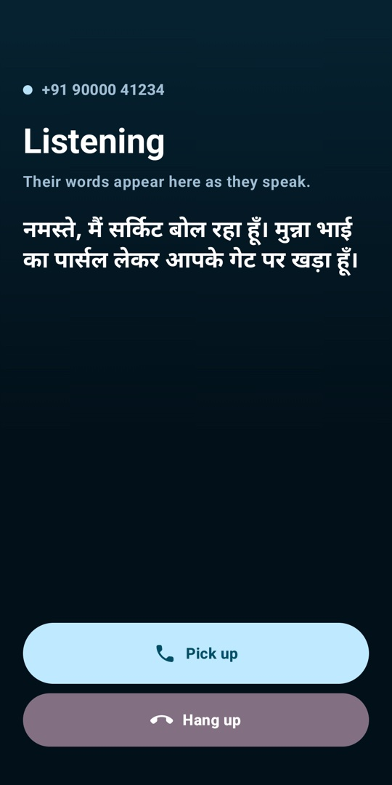
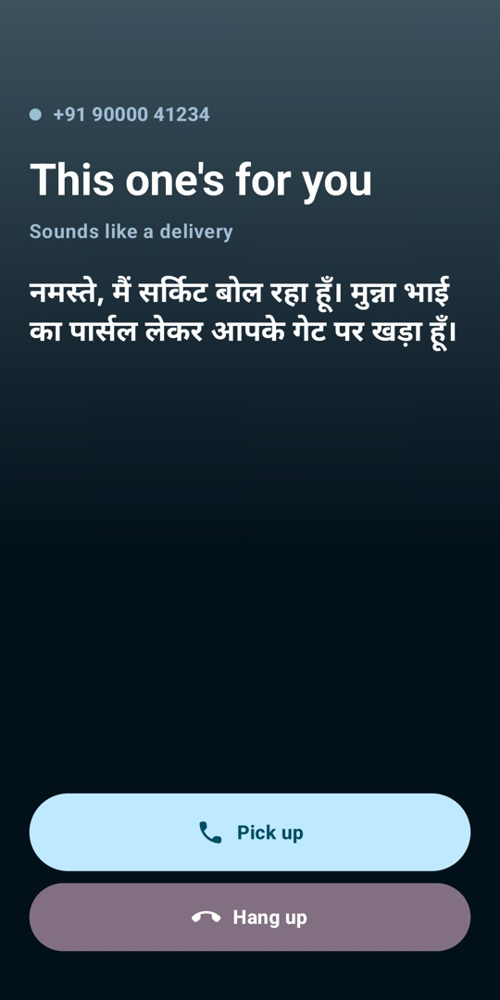

<h1 align="center">Tring++</h1>

Call recording for <a href="https://play.google.com/store/apps/details?id=io.github.jaswantk917.chitthighanti">Tring</a>, as a small add-on you install yourself.

Android lets only the phone's own system app record the call line. Any other app has one way in: an Accessibility service may use the microphone during a call. Google Play doesn't allow call recorders built that way, so Tring++ lives here instead of on Play, and does only this one thing.

Once it's installed and switched on, Tring's call screen gets a **Record** button, and Tring's settings get **Record calls by themselves**: every call, strangers only, or the people you pick.

Open the recorder to find your calls: play them, read what was said, and see a few lines on what each call was about, plus **Lately**, what you've been talking about across your recent calls. All of it is made on the phone.

  &nbsp;
  &nbsp;
  &nbsp;
  

## Screening and messages

With [Shizuku](https://shizuku.rikka.app/) running, Tring++ can also answer calls quietly for you:

- **Screen unknown callers:** a stranger who has never called you hears a short greeting and says why they're calling. You watch their words as they speak and can pick up any time. It rings if it sounds important, and otherwise keeps a message.
- **Take a message when you don't pick up:** a call that rang you and is still ringing at 27 seconds, just before the network gives up at 30, hears the same greeting and can leave a message of up to a minute. Calls Tring kept quiet, like strangers it silenced, are left alone. Pick up any time while they talk. It's on by default once screening is set up.
- **Pick up partway:** if the call is being recorded, what they said before you picked up opens the recording, so its transcript starts from their first word.

Messages are kept like recordings, with their words and a note saying who called. Set it up in Tring++ under **Call screening**: start Shizuku (again after every restart), tap **Allow**, and switch it on. The greeting uses your phone's own voice, so add a Hindi voice in the phone's text-to-speech settings. Some phones won't share a call's sound with an app; there, calls keep ringing as usual.

## Set it up

You need Tring as your phone app (its Ghanti side), on Android 10 or newer.

1. **Download** `tring-recorder-x.y.apk` from [Releases](https://github.com/jaswantk917/tring-recorder/releases) on your phone and open it. If Android asks, allow your browser or file manager to install apps.
   - **"Blocked by Play Protect"?** In India and some other countries, Google blocks apps downloaded from a browser or file manager if they ask for Accessibility, which this one needs to record. Either:
     - pause it for the install: **Play Store → your picture → Play Protect → ⚙ → turn off Scan apps with Play Protect**, install, and turn it back on (the recorder reminds you), or
     - install from a computer instead: `adb install tring-recorder-x.y.apk`, which isn't blocked.
2. **Open Tring++** and tap **Allow** next to *Microphone*, then next to *A note when a recording is saved*.
3. Tap **Open** next to *Turn on Tring++ in Accessibility*, pick **Tring++**, and switch it on.
4. **Is the switch greyed out?** Android 13 and newer block Accessibility for apps installed from a file until you say otherwise:
   1. Go back to Tring++ and tap **Open App info**.
   2. Tap **⋮** in the top corner, then **Allow restricted settings**, and confirm with your PIN or fingerprint.
   3. Repeat step 3.
5. Tring++ says **All set**. Close Tring from your recent apps once and open it again, so it finds the recorder.

To test it, call someone, tap **Record**, say a few words each, and hang up. A *Call recorded* note appears; tap it to play the recording and read it.

**New versions:** the recorder checks GitHub once a day and tells you when one is out. Tap **Download**, open the file, and install it over the old one; your recordings, transcripts and summaries stay. The Play Protect block in step 1 can come up again.

## What to expect

- **Where recordings go:** `Recordings/Tring` on Android 12 and newer, `Music/Tring recordings` before that. Each one is named after the person and the time.
- **How they sound:** the recorder hears the room, not the phone line. You come through clearly. The other person reaches the microphone from the earpiece or speaker, so after the call the recorder tells the two of you apart and brings them up to your loudness. On speaker they sound close to natural. On the earpiece they're quieter to begin with and come out thinner, like a phone voice.
- **Your phone's own call recorder**, if it has one, records the line itself and will always sound better. Use this where there isn't one.
- **Transcripts** come from [Shruti](#credits), a speech model for Hindi, English and Hinglish that runs inside the app, offline, on any phone with a 64-bit ARM processor (nearly every phone from the last several years). Each call is transcribed right after it ends (older ones when you open the app). Lines aren't marked by who said them, because telling two voices apart from one microphone was too often wrong.
- **Clearer transcripts** are optional and for Hindi calls. Open a call and tap **Download** once, then **Write it** on any call you choose. It uses [AI4Bharat's IndicConformer](#credits), which makes out calls far better than Shruti, and it runs offline with a note and a **Stop** while it works.
  - The card only appears on phones that can run it: **4 GB of RAM or more** and a processor from roughly 2018 on (Cortex-A55 or newer).
  - The download is **926 MB** and needs **1.9 GB free** while it unpacks; 926 MB stays on the phone until you remove it in the recorder's setup screen. On mobile data it tells you first. A download that gets cut off picks up where it stopped.
  - It works the phone hard for a few minutes and takes over 1 GB of memory. It has only been tested on a Pixel 9, so expect slower on other phones. If the phone gets too warm or Android needs the memory back, it stops and tells you; your call and its first transcript are untouched.
- **Summaries** use Gemini Nano, Google's on-device model, which only some phones have (Pixel 9 and newer, and a few others). Android lets it work only for the app on screen, so they're made while the recorder is open. Without Gemini Nano you get transcripts and no summaries. A call with only a few clear words gets none (*Too short to tell what it was about*) rather than a guess. Where a phone does let Gemini Nano work in the background, the summary arrives as a notification after the call, in its own *Call summaries* channel.
- **In Tring:** each recording also shows up in Tring's Recents, under the call it was made during. Play it there, see its summary, or tap *Transcript* to open it here.
- **For assistants:** on Android 16 and newer the recorder offers two [app functions](https://developer.android.com/ai/appfunctions), *list recent calls* and *what I've been talking about*, which read what is already saved. Google's Gemini calls app functions only from apps it has approved, and this one isn't, so for now they're for assistants that use the system's app-function command, or `adb shell cmd app_function`.

## Privacy

- It uses the internet for two things: asking GitHub once a day for the newest version number, and fetching the clearer-transcript model from this repository's releases if you tap **Download**. Recordings, transcripts and summaries never leave your phone unless you share them.
- It can't read your screen. Its Accessibility service asks for no window content, only for being allowed the microphone during a call.
- It records only when Tring asks it to: your tap, or the auto-record setting you chose.
- Recording calls is legal in some places and needs everyone's consent in others. Know the rule where you are, and tell people when they're being recorded.

## Turn it off

Switch Tring++ off in Accessibility, or uninstall it. Tring's Record button and auto-record setting disappear with it.

## Source

The code lives in [`recorder/`](https://github.com/jaswantk917/chitthi-ghanti/tree/main/recorder) in Tring's repository, beside the app it works with.

## Credits

Transcripts use **Shruti** by Udgam Labs, a version of [Cactus Whistle](https://huggingface.co/Cactus-Compute/whistle) retrained on Hindi, English and Hinglish speech, running in the [Cactus needle](https://huggingface.co/Cactus-Compute/needle3) engine. Both are under the Apache License 2.0; the full notice, with the training data's credits, ships in the app and is in [`recorder/src/main/assets/shruti/NOTICE`](https://github.com/jaswantk917/chitthi-ghanti/blob/main/recorder/src/main/assets/shruti/NOTICE).

Clearer transcripts use [**IndicConformer**](https://huggingface.co/ai4bharat/indic-conformer-600m-multilingual) by AI4Bharat (its Hindi parts, with the encoder quantized to 8 bits), running in [ONNX Runtime](https://github.com/microsoft/onnxruntime). Both are under the MIT License; the notice ships in the app and is in [`recorder/src/main/assets/indic/NOTICE`](https://github.com/jaswantk917/chitthi-ghanti/blob/main/recorder/src/main/assets/indic/NOTICE).
